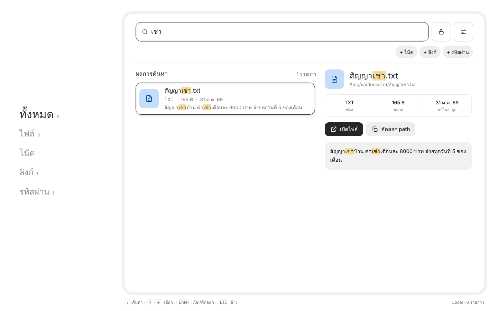
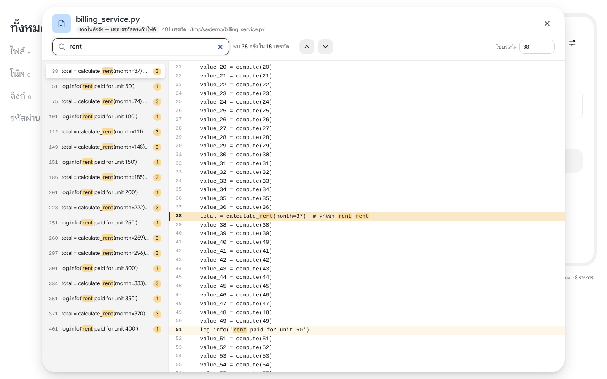
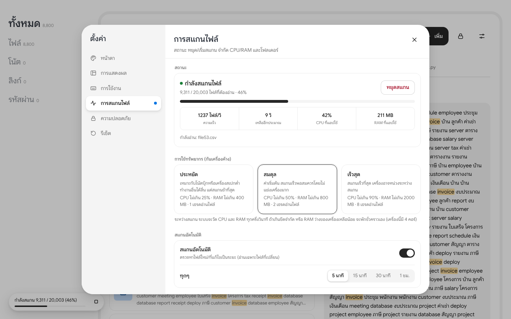

# Search Anything

ช่องค้นหาช่องเดียว ค้นได้ทุกอย่าง: **ชื่อไฟล์ เนื้อหาในไฟล์ โน้ต ลิงก์ (bookmark) และรหัสผ่าน**
พิมพ์แล้วเห็นผลลัพธ์ทันที ไม่ต้องไล่เปิดหลายที่

- ค้นภาษาไทยได้ แม้คำจะติดกันไม่เว้นวรรค (ใช้ SQLite FTS5 แบบ trigram จับคำย่อยตั้งแต่ 3 ตัวอักษร)
- คำที่สั้น 1–2 ตัวอักษร ค้นจากชื่อไฟล์/path และโน้ต ลิงก์ รหัสผ่าน (ไม่ไล่ค้นในเนื้อหาไฟล์ เพราะช้ามากเมื่อมีไฟล์เยอะ)
- อัปโหลดไฟล์ได้ทั้งสองโหมด: กดปุ่ม **อัปโหลด** หรือลากไฟล์มาวางที่ไหนก็ได้ในหน้าเว็บ ค้นหาได้ทันทีที่อัปโหลดเสร็จ
- อ่านเนื้อหาได้หลายชนิด (ดูตารางด้านล่าง) ส่วนไฟล์ชนิดอื่น (รูป วิดีโอ ฯลฯ) ค้นได้จากชื่อไฟล์และชื่อโฟลเดอร์
- ปุ่ม **ดูเนื้อหา** เปิดไฟล์ในแอปพร้อมเลขบรรทัด บอกว่าเจอคำค้นกี่ครั้งในกี่บรรทัด และกดไปที่บรรทัดนั้นได้ — เปิดไฟล์ใหญ่ระดับหลายสิบ MB / หลายแสนบรรทัดได้ทันที (อ่านเฉพาะส่วนที่แสดง)
- ค้นแล้วเจอเยอะ: หัวรายการบอกจำนวนทั้งหมด ("พบ 18,000 รายการ · แสดง 150 จาก 18,000") และเลื่อนลงเพื่อโหลดเพิ่มทีละชุดเอง
- เรียงผลลัพธ์ได้ 7 แบบ: เกี่ยวข้องที่สุด / แก้ไขล่าสุด / เก่าที่สุด / ชื่อ ก→ฮ / ชื่อ ฮ→ก / ขนาดใหญ่สุด / ประเภท
- รหัสผ่านเข้ารหัสด้วย master password (scrypt + Fernet) ค้นได้จากชื่อ / username / URL แต่ตัวรหัสผ่านไม่ถูกเก็บเป็นข้อความธรรมดาและไม่ถูกนำไปค้นหา
- ตู้รหัสผ่านล็อกตัวเองอัตโนมัติเมื่อไม่ได้ใช้ 15 นาที



## เริ่มใช้งานด้วยคำสั่งเดียว

ดาวน์โหลดโปรเจกต์ (ปุ่ม Code → Download ZIP แล้วแตกไฟล์ หรือใช้ `git clone`) จากนั้น:

| เครื่อง | ทำแบบนี้ |
|---|---|
| **Mac** | ดับเบิลคลิก `start.command` (ครั้งแรกถ้า macOS เตือน: คลิกขวา → Open) หรือรัน `./start.command` ใน Terminal |
| **Windows** | ดับเบิลคลิก `start.bat` |

สคริปต์จะเลือกวิธีรันให้เอง:

1. **ถ้ามี Docker และเปิดอยู่** (Docker Desktop บน Mac/Windows) จะรันใน Docker
   - build image ครั้งแรกใช้เวลาไม่กี่นาที ครั้งต่อไปเร็ว ถ้า build ไม่ได้ (เช่นไม่มีเน็ต) จะใช้ image ที่เคย build ไว้
   - โฟลเดอร์ที่ค้นหาถูก mount แบบ **อ่านอย่างเดียว** แอปแก้หรือลบไฟล์ของคุณไม่ได้ แต่ในแอปยังแสดง path จริงของเครื่อง
   - เปิดพอร์ตเฉพาะ `127.0.0.1` เข้าได้จากเครื่องนี้เท่านั้น
   - ข้อมูลเก็บใน Docker volume `search-anything-data`
   - ปุ่ม "เปิดไฟล์" จะเป็น "ดาวน์โหลด" แทน เพราะในคอนเทนเนอร์ไม่มีโปรแกรมให้เปิดไฟล์
2. **ถ้าไม่มี Docker** จะใช้ Python
   - หาหรือติดตั้ง Python 3.10 ขึ้นไปให้ (Mac ใช้ Homebrew, Windows ใช้ winget)
   - สร้าง `.venv` และติดตั้ง package ให้ ข้อมูลเก็บใน `./data`
   - ปุ่ม "เปิดไฟล์" เปิดด้วยโปรแกรมในเครื่องได้

ทั้งสองแบบจะเปิด browser ให้เองเมื่อแอปพร้อม และครั้งแรกจะค้นไฟล์ใน Documents, Desktop และ Downloads (เปลี่ยนได้ด้วย `--folder`)

ตัวเลือกที่ใช้ได้:

| ตัวเลือก | ใช้ทำอะไร |
|---|---|
| `--docker` | บังคับใช้ Docker |
| `--no-docker` | บังคับใช้ Python |
| `--folder PATH` | กำหนดโฟลเดอร์ที่ค้น (ใส่ซ้ำได้หลายโฟลเดอร์) |
| ตัวแปร `SA_PORT` | เปลี่ยนพอร์ต (ค่าเริ่มต้น 8765) |

ตัวอย่าง:

```bash
./start.command --folder ~/Work
```

```bat
start.bat --no-docker --folder D:\Work
```

วิธีปิดแอป: กด `Ctrl+C` หรือปิดหน้าต่าง Terminal/คอนโซล ถ้าเปิดสคริปต์ใหม่ ระบบจะปิดคอนเทนเนอร์ตัวเก่าที่ค้างอยู่ให้ก่อน

> ข้อมูลของโหมด Docker (volume) กับโหมด Python (`./data`) แยกกัน เพื่อความปลอดภัยของฐานข้อมูล SQLite ถ้าสลับโหมด โน้ต/รหัสผ่านที่บันทึกไว้จะอยู่กับโหมดเดิม

## คู่มือในแอป

กดปุ่ม **?** ข้างช่องค้นหา (หรือกดปุ่ม `?` บนคีย์บอร์ด) จะเจอ "น้องค้น" พร้อมการ์ดอธิบายทุกเมนูและวิดีโอสั้นของแต่ละเมนู ปุ่ม **เริ่มทัวร์ 1 นาที** จะพาชี้ทีละจุดบนหน้าจอจริง ครั้งแรกที่เปิดแอประบบจะชวนดูทัวร์ (กดข้ามได้)

วิดีโอการใช้งานแต่ละเมนู (ไฟล์ MP4 อยู่ใน `search_anything/static/guide/`):
[ค้นหา](search_anything/static/guide/search.mp4) ·
[เพิ่มข้อมูล](search_anything/static/guide/add.mp4) ·
[อัปโหลด & ลากวาง](search_anything/static/guide/upload.mp4) ·
[เลือกประเภท](search_anything/static/guide/filters.mp4) ·
[รายละเอียด](search_anything/static/guide/detail.mp4) ·
[ดูเนื้อหา & ไปบรรทัด](search_anything/static/guide/viewer.mp4) ·
[เรียงลำดับ](search_anything/static/guide/sort.mp4) ·
[ตู้รหัสผ่าน](search_anything/static/guide/vault.mp4) ·
[การสแกนไฟล์](search_anything/static/guide/scan.mp4) ·
[ปรับหน้าตา](search_anything/static/guide/settings.mp4)

ถ้าหน้าตาแอปเปลี่ยน อัดวิดีโอใหม่ได้ด้วย `tools/record-guide-videos.js` (ดู [tools/README.md](tools/README.md))

## ไฟล์ที่อ่านเนื้อหาได้

| กลุ่ม | ชนิดไฟล์ |
|---|---|
| ข้อความและโค้ด | txt, md, csv, json, yaml, xml, log, โค้ดกว่า 80 ภาษา, Dockerfile, Makefile และไฟล์ข้อความอื่นๆ ที่ไม่รู้จักนามสกุล (ถ้าเป็นข้อความล้วน UTF-8) |
| เอกสาร | pdf, docx (รวมข้อความในตาราง), doc (Word 97-2003), rtf (รองรับภาษาไทย cp874), odt, epub, html |
| ตาราง | xlsx, xlsm (ทุกชีต), xls (Excel 97-2003), ods, csv, tsv |
| สไลด์ | pptx (รวม speaker notes และตาราง), ppt (PowerPoint 97-2003), odp |
| อื่นๆ | eml (อีเมล: หัวเรื่อง ผู้ส่ง เนื้อหา ชื่อไฟล์แนบ), ipynb (โค้ดและผลลัพธ์), zip (รายชื่อไฟล์ข้างใน) |
| ภาพสแกน (OCR) | PDF ที่สแกนมา (ภาษาไทย + อังกฤษ) และรูปภาพ jpg, png, tiff, bmp, webp (เปิดในตั้งค่า) |

หลังอัปเดตเป็นเวอร์ชันนี้ ระบบจะอ่านไฟล์เดิมใหม่หนึ่งรอบเองเพื่อดึงเนื้อหาชนิดที่เพิ่งรองรับ

**ไฟล์ Office รุ่นเก่า (97-2003)** (`search_anything/legacy.py`, และ `native/src/legacy.rs` ที่เร็วกว่า 5-12 เท่า):
- **.doc / .dot**: ข้อความทั้งเอกสาร รวมเชิงอรรถ หัว/ท้ายกระดาษ และกล่องข้อความ ตัดโค้ดของ field ออก (ลิงก์แสดงข้อความ ไม่ใช่ `HYPERLINK ...`) และแยกเซลล์ตารางด้วยแท็บ
- **.xls / .xlt**: เหมือน .xlsx คือชื่อชีต แล้วตามด้วยแถวที่มีข้อมูล ตัวเลขและวันที่แสดงแบบเดียวกัน
- **.ppt / .pps / .pot**: ข้อความทุกสไลด์และโน้ต ข้ามข้อความแม่แบบของ master ("Click to edit Master title style")
- ไฟล์ที่ตั้งรหัสผ่าน หรือไฟล์รุ่นเก่ากว่านั้น (Word 6/95) อ่านเนื้อหาไม่ได้ แต่ยังค้นจากชื่อไฟล์ได้
- ทดสอบโดยแปลงไฟล์ในชุดทดสอบ 90 ไฟล์เป็นรูปแบบเก่าด้วย LibreOffice: ตัวอ่าน Rust และ Python ได้ข้อความตรงกันทุกไฟล์ และพบทุกคำของไฟล์ต้นฉบับ

PDF ภาษาไทยบางไฟล์เก็บวรรณยุกต์และสระเป็นรหัสพิเศษของฟอนต์ (เช่น `เช\uf70aา`) หรือเก็บ "ำ" เป็นสองตัว ทำให้เดิมค้นไม่เจอ ตอนนี้ระบบแปลงกลับเป็นตัวอักษรปกติแล้ว และอ่าน PDF ด้วย pdfium ซึ่งเร็วกว่าเดิมราว 15 เท่า (PDF ข้อความ 154 หน้า: 11.7 → 0.75 วินาที)

## ค้นหาเอกสารสแกน (OCR)

PDF ที่สแกนจากเครื่องสแกนหรือถ่ายรูปเอกสาร ไม่มีข้อความอยู่ข้างใน เดิมจึงค้นได้แค่จากชื่อไฟล์ ตอนนี้ระบบอ่านตัวอักษรจากภาพ (OCR) ด้วย [Tesseract](https://github.com/tesseract-ocr/tesseract) ภาษาไทย + อังกฤษ แล้วค้นหาได้เหมือนข้อความปกติ

- ทำงาน **หลัง** สแกนไฟล์ปกติเสร็จ ทีละไฟล์ ไฟล์ใหม่ล่าสุดก่อน ด้วย priority ต่ำ และอยู่ใต้ตัวเบรก CPU/RAM เหมือนเดิม จึงไม่ทำให้ผลค้นหาทั่วไปช้าลง
- อ่านเฉพาะหน้าที่ไม่มีข้อความ (PDF ที่มีข้อความจริงอยู่แล้วไม่ถูก OCR ซ้ำ) ที่ 300 dpi ประมาณ 1–1.5 วินาทีต่อหน้า
- อ่านครั้งเดียวต่อไฟล์ ผลเก็บไว้ในตาราง `ocr` อ่านใหม่เฉพาะเมื่อไฟล์เปลี่ยน กด **หยุดสแกน** ได้ทุกเมื่อ (หยุดภายในไม่ถึง 1 วินาที) ครั้งถัดไปทำต่อจากไฟล์ที่ค้างอยู่
- ในหน้าดูเนื้อหา ข้อความจาก OCR อยู่ใต้หัวข้อ `=== ข้อความจากภาพสแกน (OCR) ===` แยกตามหน้า (`--- หน้า 3 ---`)
- ตั้งค่าได้ที่ **ตั้งค่า → การสแกนไฟล์ → อ่านข้อความจากภาพสแกน (OCR)**: เปิด/ปิด, อ่านข้อความในรูปภาพ (เปิดเป็นค่าเริ่มต้น), จำนวนหน้าสูงสุดต่อไฟล์
- **ข้อความในรูปภาพ** (jpg, png, gif, tiff, bmp, webp) เช่น รูปถ่ายเอกสาร ภาพหน้าจอ สลิปโอนเงิน ค้นหาได้เหมือนข้อความปกติ ระบบเก็บเฉพาะบรรทัดที่ Tesseract อ่านได้ชัด (ความมั่นใจเฉลี่ยของบรรทัด ≥ 60 จาก 100) รูปที่ไม่มีตัวหนังสือ เช่น คนหรือวิว จึงไม่มีตัวอักษรขยะเข้าไปในดัชนี รูปละประมาณ 0.3–3 วินาที ทำเบื้องหลังหลังสแกนเสร็จเหมือน PDF

ติดตั้ง Tesseract (ถ้ารันผ่าน Docker มีให้แล้ว ไม่ต้องทำอะไร):

```bash
brew install tesseract tesseract-lang
```

```bash
sudo apt install tesseract-ocr tesseract-ocr-tha
```

Windows: ติดตั้งจาก [UB Mannheim](https://github.com/UB-Mannheim/tesseract/wiki) แล้วติ๊ก **Thai** ใน Additional language data · ถ้าติดตั้งไว้ที่อื่น ตั้ง `SA_TESSERACT` เป็น path ของ `tesseract.exe`

## ดูเนื้อหาในไฟล์



- กด **ดูเนื้อหา** ที่ผลลัพธ์ (ไฟล์และโน้ต) หรือในแผงรายละเอียด
- ด้านซ้ายแสดงทุกบรรทัดที่เจอคำค้น พร้อมจำนวนครั้งในแต่ละบรรทัด กดเพื่อกระโดดไปบรรทัดนั้น
- `Enter` / `Shift+Enter` (หรือ `F3`) ไปคำที่เจอถัดไป/ก่อนหน้า, ช่อง "ไปบรรทัด" กระโดดไปเลขบรรทัด, กดเลขบรรทัดเพื่อคัดลอก `ไฟล์:บรรทัด`
- ไฟล์ข้อความ/โค้ดอ่านจากไฟล์จริง เลขบรรทัดจึงตรงกับไฟล์ ส่วน PDF/Office แสดงข้อความที่ดึงออกมา

## ติดตั้งเอง (แบบละเอียด)

ต้องใช้ Python 3.10 ขึ้นไป

```bash
python -m venv .venv
```

```bash
source .venv/bin/activate   # Windows: .venv\Scripts\activate
```

```bash
pip install -r requirements.txt
```

## โหมด Local (ใช้บนเครื่องตัวเอง)

```bash
python -m search_anything --folder ~/Documents --folder ~/Desktop
```

แล้วเปิด http://localhost:8765

- รันอยู่บน `127.0.0.1` เท่านั้น เครื่องอื่นเข้าไม่ได้ จึงไม่ต้องล็อกอิน
- เพิ่ม/ลบโฟลเดอร์ที่ให้ค้นได้จาก ⚙️ ในหน้าเว็บ (ระบบจำไว้ให้)
- กด Enter ที่ผลลัพธ์ที่เป็นไฟล์ จะเปิดไฟล์ด้วยโปรแกรมปกติของเครื่อง

## โหมด Server (เข้าจากที่ไหนก็ได้)

```bash
SA_PASSWORD='รหัสผ่านสำหรับล็อกอิน' python -m search_anything --mode server --folder /srv/files
```

- ต้องล็อกอินด้วย `SA_PASSWORD` ก่อนใช้งาน (ระบบนี้ออกแบบให้ใช้คนเดียว)
- ไฟล์ที่อัปโหลดเก็บใน `data/uploads/` (ทั้งสองโหมด) และลบได้จากหน้าเว็บ ส่วนไฟล์ในโฟลเดอร์ของคุณเองจะไม่มีปุ่มลบ
- ไฟล์ที่ค้นเจอจะ **ดาวน์โหลด** แทนการเปิดในเครื่อง
- ถ้าเปิดให้เข้าจากอินเทอร์เน็ต ควรวางไว้หลัง HTTPS (เช่น Caddy, nginx, Cloudflare Tunnel) และใส่ `--https-cookie`
- จำกัดชื่อโดเมนที่รับได้ด้วย `--allowed-host search.example.com` ได้

## Docker / Kubernetes / Rancher

```bash
docker build -t search-anything .
```

```bash
docker run -d -p 8765:8765 -e SA_PASSWORD='รหัสผ่าน' -v search-anything-data:/data search-anything
```

ข้อมูลทั้งหมดอยู่ที่ `/data` **ต้องผูก volume ถาวรไว้เสมอ** ไม่อย่างนั้นข้อมูลจะหายเมื่อสร้าง container หรือ pod ใหม่ ส่วน Rancher ดูคู่มือทีละขั้นได้ที่ [docs/deploy-rancher.md](docs/deploy-rancher.md) หรือใช้ไฟล์ [deploy/rancher.yaml](deploy/rancher.yaml) กับปุ่ม Import YAML

## ตัวเลือกทั้งหมด

| ตัวเลือก | ตัวแปร environment | ค่าเริ่มต้น | ความหมาย |
|---|---|---|---|
| `--mode` | `SA_MODE` | `local` | `local` หรือ `server` |
| `--host` | `SA_HOST` | `127.0.0.1` (local) / `0.0.0.0` (server) | address ที่รับการเชื่อมต่อ |
| `--port` | `SA_PORT` | `8765` | พอร์ต |
| `--data-dir` | `SA_DATA_DIR` | `data` | ที่เก็บฐานข้อมูลและไฟล์อัปโหลด |
| `--folder` (ใส่ซ้ำได้) | `SA_FOLDERS` (คั่นด้วย `:` หรือ `;` บน Windows) | – | โฟลเดอร์ที่จะสแกน |
| `--reindex-interval` | `SA_REINDEX_INTERVAL` | `300` | ความถี่สแกนอัตโนมัติเริ่มต้น (วินาที) ถ้ายังไม่ได้ตั้งในหน้าตั้งค่า |
| `--auto-lock` | `SA_AUTO_LOCK` | `900` | ล็อกตู้รหัสผ่านหลังไม่ได้ใช้กี่วินาที |
| `--allowed-host` | `SA_ALLOWED_HOSTS` (คั่นด้วย `,`) | `*` (server) | ชื่อโดเมนที่อนุญาต |
| `--https-cookie` | `SA_HTTPS_COOKIE=1` | ปิด | ส่ง cookie ผ่าน HTTPS เท่านั้น |
| `--max-upload-mb` | `SA_MAX_UPLOAD_MB` | `200` | ขนาดไฟล์อัปโหลดสูงสุดต่อไฟล์ (MB) |
| – | `SA_PASSWORD` | – | รหัสผ่านล็อกอิน (จำเป็นในโหมด server) |
| – | `SA_TESSERACT` | หาเอง (PATH, Homebrew, `C:\Program Files\Tesseract-OCR`) | path ของโปรแกรม `tesseract` สำหรับ OCR |
| – | `SA_NATIVE=0` | เปิด | ปิดตัวอ่าน Rust (ใช้ตัวอ่าน Python แทน) |

## คีย์ลัด

| ปุ่ม | ทำอะไร |
|---|---|
| `/` หรือ `Ctrl/⌘ + K` | ไปที่ช่องค้นหา |
| `↑` `↓` | เลือกผลลัพธ์ |
| `Enter` | ไฟล์ → เปิด/ดาวน์โหลด · ลิงก์ → เปิดเว็บ · รหัสผ่าน → คัดลอก · โน้ต → แก้ไข (เปลี่ยนเป็น "ดูรายละเอียด" ได้ในตั้งค่า) |
| `Shift + Enter` | ทำอีกแบบ (ดูรายละเอียด ↔ เปิดทันที) |
| `Esc` | ปิดเมนู/รายละเอียด/ตั้งค่า หรือล้างช่องค้นหา |

## หน้าตา (UI)

ค่าเริ่มต้น **แสดงครบทุกส่วน**: เมนูประเภทด้านซ้าย, รายละเอียดด้านข้าง, แถบสถานะการสแกน (พร้อมปุ่มหยุด), แถบคีย์ลัด และปุ่มตู้รหัสผ่าน ส่วนไหนไม่ชอบก็ปิดได้ที่ปุ่มตั้งค่า (ไอคอนแถบเลื่อนข้างปุ่มเพิ่ม) หรือเลือกชุด "เรียบ" ที่เหลือแค่ช่องค้นหา ปุ่มเพิ่ม และผลลัพธ์



หน้าตั้งค่าแบ่งเป็น 6 หมวด:

| หมวด | ปรับอะไรได้ |
|---|---|
| หน้าตา | ธีม (ตามระบบ/สว่าง/มืด), สีหลัก (7 สี หรือเลือกเอง), ขนาดตัวอักษร, ฟอนต์, มุมเหลี่ยม/มน, ความหนาแน่น, ภาพเคลื่อนไหว |
| การแสดงผล | รูปแบบหน้า (มีกรอบ/เรียบ), ตัวกรองประเภท (เมนูซ้าย/แท็บ/ซ่อน), รายละเอียด (ด้านข้าง/เปิดเมื่อคลิก), ไอคอน, ข้อความตัวอย่าง, รายการล่าสุด, แถบสถานะการสแกน, แถบคีย์ลัด, ปุ่มตู้รหัสผ่าน |
| การใช้งาน | ปุ่ม Enter ทำอะไร, จำนวนผลลัพธ์, รายการคีย์ลัด |
| การสแกนไฟล์ | สถานะสด (ความคืบหน้า, ความเร็ว, เวลาที่เหลือ, CPU/RAM ที่ใช้, ไฟล์ที่กำลังอ่าน), ปุ่ม **หยุด/เริ่มสแกน**, โหมดประหยัด/สมดุล/เร็วสุด, สแกนอัตโนมัติ + ความถี่, โฟลเดอร์ |
| ความปลอดภัย | ล็อก/ปลดล็อกตู้รหัสผ่าน, ออกจากระบบ (โหมด server) |
| รีเซ็ต | ชุดสำเร็จรูป "แสดงครบ" / "เรียบ" และปุ่มคืนค่าหน้าตาเริ่มต้น |

การตั้งค่าหน้าตาบันทึกไว้ใน browser (localStorage) ส่วนการตั้งค่าการสแกนบันทึกไว้ที่เครื่องที่รันแอป

## การสแกนไฟล์และการกันเครื่องค้าง

- **หยุดได้ทุกเมื่อ:** ไฟล์ที่สแกนแล้วยังค้นหาได้ กดเริ่มใหม่จะอ่านเฉพาะส่วนที่เหลือ ถ้าหยุดระหว่างสำรวจโฟลเดอร์ ระบบจะไม่ลบอะไรออกจากดัชนี
- **ติดตามสถานะได้:** มุมซ้ายล่างของหน้าจอ (กดเพื่อดูละเอียด) และในหมวด "การสแกนไฟล์"
- **ตัวเบรก:** ระหว่างสแกนจะวัด CPU/RAM ทุกครึ่งวินาที แล้วพักชั่วคราวเมื่อ
  - แอปใช้ CPU หรือ RAM เกินขีดจำกัดของโหมด
  - RAM ว่างของเครื่องเหลือน้อยกว่า 400 MB
  - เครื่องกำลังทำงานหนักจากโปรแกรมอื่น (CPU รวมเกิน 90%) ข้อนี้ใช้กับโหมดประหยัดและสมดุลเท่านั้น
- **ไม่ค้างตลอดไป:** ระหว่างพัก ระบบยังค่อยๆ อ่านต่อทีละไฟล์ทุก 5 วินาที
- **สแกนใน process แยก (worker):** หน้าเว็บจึงไม่ช้าลงระหว่างสแกน (วัดได้: ค้นหาระหว่างสแกน 20,000 ไฟล์ กลาง 20 ms)
- **ลดความสำคัญทั้ง process:** Linux และ macOS ใช้ `nice 10` (Linux อ่านดิสก์แบบ idle ด้วย) ส่วน Windows ใช้ระดับ Below normal และลดความสำคัญของการอ่านดิสก์ โปรแกรมที่ใช้งานอยู่จึงได้ CPU ก่อน
- **เพดาน RAM จริง:** ตัวควบคุมวัด RAM ของ worker ทุก 0.25 วินาที ถ้าเกินเพดาน (1.5 เท่าของขีดจำกัดในโหมด) จะหยุด worker ทันที โดยหน้าเว็บยังทำงานต่อได้
- **ล่มแล้วเริ่มใหม่เอง:** worker ที่ถูกหยุดหรือล่มจะเริ่มใหม่ในโหมดระวัง (อ่านทีละไฟล์และแจ้งชื่อไฟล์ก่อนอ่าน) เพื่อหาไฟล์ต้นเหตุ ไฟล์นั้นจะถูกเก็บแค่ชื่อ (ยังค้นจากชื่อได้) แล้วสแกนต่อ ดูรายชื่อและกด "ลองใหม่" ได้ในหมวด "การสแกนไฟล์" และถ้าล่มเกิน 8 ครั้งในรอบเดียวจะยกเลิกการสแกนรอบนั้น

| โหมด | ขีดจำกัด | วัดจริง (20,000 ไฟล์, 4 คอร์) |
|---|---|---|
| ประหยัด | CPU 25%, RAM 400 MB, อ่านไฟล์ 1 เธรด | 24 s · CPU เฉลี่ย 23% · RAM 169 MB |
| สมดุล (ค่าเริ่มต้น) | CPU 50%, RAM 800 MB, อ่านไฟล์ 2 เธรด | 17 s · CPU เฉลี่ย 41% · RAM 169 MB |
| เร็วสุด | CPU 90%, RAM 2 GB, อ่านไฟล์ 8 เธรด | 14 s · CPU เฉลี่ย 56% · RAM 174 MB |

ทดสอบกับโปรแกรมอื่นที่ใช้ CPU 100% ทุกคอร์: การสแกนในโหมดสมดุลลดลงเหลือ 0–3% และขึ้นข้อความว่าพักชั่วคราว พอโปรแกรมนั้นจบก็สแกนต่อเองที่ราว 45%

### ดีไซน์

ดีไซน์อ้างอิงสไตล์ส่วน profile showcase ของ fastwork.com (ค่าสี ขนาด และ motion วัดจากหน้าเว็บจริง แต่เขียนโค้ดใหม่ทั้งหมด ไม่มีโลโก้หรือไฟล์ของเขา)

- **สี:** โทนกลาง ปุ่มหลักสีเกือบดำ `#262626` ตัวอักษร `#171717` / `#737373` เส้นขอบ `#ebebeb` / `#d4d4d4` ไอคอนแต่ละประเภทใช้สีพาสเทล มี dark mode ตามการตั้งค่าเครื่อง
- **รูปทรง:** มุมโค้ง 6 / 12 / 16 px (ปรับได้) ปุ่มเลือกแบบแคปซูล โหมด "มีกรอบ" ใช้กรอบหนา 8 px มุม 32 px
- **Motion:** ผลลัพธ์ค่อยๆ ปรากฏแบบเบลอ→ชัดพร้อมเลื่อนขึ้นทีละรายการ, เมนูซ้ายตัวใหญ่ขยายเมื่อเลือก, ปุ่มยุบ 0.98 เมื่อกด (easing `cubic-bezier(.22,1,.36,1)`) และปิด animation อัตโนมัติถ้าเครื่องตั้ง reduce motion
- **ฟอนต์:** Google Sans ตัวเดียวกับ fastwork (ทั้งละตินและไทย) แนบมาในแอปที่ `static/fonts/` ใช้ได้แม้ออฟไลน์ ฟอนต์นี้ใช้สัญญาอนุญาต SIL Open Font License (ดู `static/fonts/OFL.txt`)
- ค่าทั้งหมดเป็น CSS variables อยู่ต้นไฟล์ `search_anything/static/style.css` แก้ที่เดียวเปลี่ยนทั้งแอป

## ผลลัพธ์จำนวนมาก

- **หน้าแรกขึ้นเร็วเหมือนเดิม** (ราว 20 ms) ถ้าผลน้อยจะรู้จำนวนทั้งหมดทันที
- **คำที่เจอเยอะ:** ระบบนับต่อเบื้องหลังหลังหยุดพิมพ์ 0.35 วินาที ใช้การเชื่อมต่อฐานข้อมูลแยก การค้นหาระหว่างนั้นจึงไม่สะดุด
- **นับนานเกิน 2.5 วินาที:** จะหยุดแล้วแสดง "มากกว่า X" และถ้าพิมพ์คำใหม่ การนับคำเก่าจะถูกยกเลิกทันที
- **โหลดเพิ่มเมื่อเลื่อนลง:** เริ่มโหลดล่วงหน้าก่อนถึงท้ายรายการ เพิ่มเฉพาะรายการใหม่ (ไม่วาดใหม่ทั้งรายการ) และ browser จะข้ามการวาดรายการที่อยู่นอกจอ ใช้ปุ่มลูกศรไล่ลงก็โหลดเพิ่มเองเหมือนกัน
- **ลำดับคงที่:** หน้าถัดไปต่อจากหน้าแรกพอดี ไม่ซ้ำ ไม่ตกหล่น
- **ตัวเลขที่วัดได้:** 20,000 ไฟล์, คำที่เจอ 18,000 ไฟล์
  - นับครบใน 0.3–0.45 วินาที
  - หน้าลึก (ลำดับที่ 5,000) โหลดใน 23 ms
  - เลื่อนโหลด 650 รายการ ไม่มีจังหวะที่หน้าจอค้างเกิน 50 ms

## ไฟล์ใหญ่ในหน้าดูเนื้อหา

- **ไม่โหลดทั้งไฟล์:** เซิร์ฟเวอร์จำตำแหน่งต้นบรรทัดไว้ (ราว 8 byte ต่อบรรทัด) แล้วอ่านเฉพาะบรรทัดที่ขอ ส่วนการค้นในไฟล์จะอ่านทีละช่วง ไม่ดึงทั้งไฟล์มาไว้ในหน่วยความจำ
- **วาดเฉพาะบรรทัดบนจอ:** browser วาดเฉพาะบรรทัดที่อยู่บนจอ (virtual scrolling) และดึงทีละ 400 บรรทัดตามตำแหน่งที่เลื่อน บรรทัดที่ยาวมากเลื่อนดูแนวนอนได้ เลขบรรทัดค้างอยู่ด้านซ้าย และเมื่อกระโดดไปคำที่เจอ ระบบจะเลื่อนแนวนอนให้เห็นคำนั้นเอง
- **ตัวเลขที่วัดได้:**

| | ก่อน | หลัง |
|---|---|---|
| เปิดไฟล์ 5 MB / 50,000 บรรทัด | 12.5 วินาที, หน้าค้าง 10 วินาที | 0.11 วินาที, ไม่ค้าง |
| element ในหน้า | 150,000 | ราว 350 (คงที่ทุกขนาดไฟล์) |
| ไฟล์ 41 MB / 400,000 บรรทัด | เปิดไม่ได้ | เปิด 0.26 วินาที, ค้นทั้งไฟล์ 1.9 วินาที |

## ความเร็ว

วัดบนชุดทดสอบ 20,000 ไฟล์ (ข้อความไทย/อังกฤษ 425 MB) เครื่อง 4 คอร์:

| | ก่อน | หลัง |
|---|---|---|
| สแกนครั้งแรก | 50.5 s | 14.0 s |
| สแกนซ้ำ (ไม่มีไฟล์เปลี่ยน) | 0.40 s | 0.10 s |
| ค้นคำที่เจอบ่อย (API) | 200–600 ms | 26–29 ms |
| ค้นคำสั้น 1–2 ตัว | 500 ms | 5 ms |

ทำได้โดย: แบ่งดัชนีไฟล์เป็น 4 ส่วนให้เขียนพร้อมกันหลายคอร์, commit เป็นชุด, อ่านไฟล์หลาย thread, เรียงผลแบบ "ชื่อตรงก่อน แล้วไฟล์ที่แก้ล่าสุด" แทน bm25 (ซึ่งต้องนับทุกเอกสาร), ตัดข้อความตัวอย่างเฉพาะผลที่แสดง และระหว่างสแกนก็ค้นหาได้เลย

### ตัวอ่านไฟล์ภาษา Rust (`native/`)

ชุดทดสอบที่ใกล้งานออฟฟิศจริงกว่า: 53,200 ไฟล์ 735 MB (ข้อความ/โค้ด 50,000 + Word 400 + Excel 300 + PowerPoint 200 + PDF 300) เครื่อง 4 คอร์ วัดด้วย `python tools/bench_scan.py`:

| | ก่อน | หลัง |
|---|---|---|
| สแกนครั้งแรก (สมดุล, ค่าเริ่มต้น) | 108 s | 32 s (3.4 เท่า) |
| สแกนครั้งแรก (เร็วสุด) | 102 s | 31 s (3.3 เท่า) |
| อ่าน Excel ต่อไฟล์ | 136 ms | 21 ms (6 เท่า) |
| อ่าน Word ต่อไฟล์ | 17 ms | 0.6 ms (31 เท่า) |
| อ่าน PowerPoint ต่อไฟล์ | 15 ms | 1.4 ms (11 เท่า) |
| อ่าน PDF ข้อความ (154 หน้า) | 11.7 s (pypdf) | 0.75 s (pdfium) |
| สแกนซ้ำ (ไม่มีไฟล์เปลี่ยน) | 0.47 s | 0.46 s |
| ค้นหา | 30–90 ms | เท่าเดิม (30–90 ms) |

ที่มาของความเร็ว:
- **Word/Excel/PowerPoint อ่านด้วย Rust** (`native/`, ใช้ calamine + roxmltree + cfb รวมถึงไฟล์รุ่นเก่า .doc/.xls/.ppt) และปล่อย GIL ระหว่างอ่าน จึงอ่านพร้อมกันได้ทุกคอร์ ข้อความที่ได้ **ตรงกับตัวอ่าน Python ทุกตัวอักษร** (ตรวจด้วย `tests/test_native.py` และเทียบกับไฟล์ทั้ง 900 ไฟล์ในชุดทดสอบ) ถ้าตัวอ่าน Rust อ่านไฟล์ไหนไม่ได้ จะลองด้วยตัวอ่าน Python ให้เอง
- **PDF อ่านด้วย pdfium ในหลาย process** (pdfium ใช้ได้ทีละไฟล์ต่อ process) ถ้า process ช่วยอ่านล่มเพราะไฟล์เสีย ตัวสแกนจะเริ่มใหม่แบบทีละไฟล์และข้ามไฟล์นั้นเหมือนเดิม และเพดาน RAM นับรวม process ช่วยอ่านด้วย
- คิวเขียนดัชนีของแต่ละส่วนไม่บล็อกกันเอง (ใช้งบหน่วยความจำรวม ~50 MB แทนคิวขนาดคงที่)

ตอนนี้เวลาที่เหลือส่วนใหญ่คือ SQLite สร้างดัชนี trigram (~40 วินาที CPU) และ pdfium (~26 วินาที CPU) ซึ่งเป็นโค้ด C/C++ อยู่แล้ว ลองปรับ SQLite หลายแบบ (cache, ขนาด page, merge, checkpoint) ได้ไม่ถึง 10% จึงไม่ได้ใส่

ไม่มี Rust ก็ใช้งานได้ปกติ (ผลเหมือนกัน แค่ช้ากว่า):
- **Docker**: build ตัวอ่าน Rust ให้อัตโนมัติ
- **venv**: ถ้าเครื่องมี Rust (`cargo`) สคริปต์ start จะ build ให้ครั้งแรกเอง ไม่มีก็ใช้ตัวอ่าน Python ติดตั้ง Rust ได้ที่ [rustup.rs](https://rustup.rs) หรือ build เอง:

```bash
pip install ./native
```

ปิดตัวอ่าน Rust ชั่วคราว (เช่น เพื่อเทียบผล): ตั้ง `SA_NATIVE=0`

## ความปลอดภัย

- **ถ้าลืม master password จะกู้รหัสผ่านที่เก็บไว้ไม่ได้**
- โน้ต ลิงก์ รหัสผ่าน อยู่ใน `data/search.db` **ควรสำรองไฟล์นี้** (รหัสผ่านถูกเข้ารหัส แต่โน้ตและลิงก์ไม่ได้เข้ารหัส)
- ดัชนีไฟล์อยู่ใน `data/search-files-0..3.db` ไม่ต้องสำรอง ลบทิ้งได้ ระบบจะสแกนสร้างใหม่เอง
- ไฟล์ที่อัปโหลดอยู่ใน `data/uploads/`
- โหมด local ตรวจ `Host` header เพื่อกันเว็บอื่นแอบเรียก API ผ่าน DNS rebinding

## ความเป็นส่วนตัว: ข้อมูลไม่ออกจากเครื่อง

แอปนี้ไม่ส่งเนื้อหาไฟล์ โน้ต รหัสผ่าน คำค้น หรือข้อมูลใช้งานไปที่ไหนเลย ไม่มี telemetry ไม่มี analytics ไม่เรียก API ภายนอก ตรวจแล้วทั้งโค้ดและ library (1 พ.ย. 2569):

**ตรวจขณะรันจริง:** รันแอปด้วย `strace -f -e trace=connect,sendto,sendmsg,bind` ใช้ทุกฟีเจอร์:
- สแกนไฟล์ Word, Excel, PowerPoint, PDF และไฟล์ข้อความ
- OCR ทั้ง PDF และรูปภาพ
- ค้นหา, ดูเนื้อหา, อัปโหลด, โน้ต, ลิงก์, ตู้รหัสผ่าน

ผลจาก 14 process (แอป, ตัวสแกน, process ช่วยอ่าน PDF, Tesseract): การเชื่อมต่อเครือข่ายมีแค่ `bind 127.0.0.1:<port>` (เปิดรับเบราว์เซอร์ของเครื่องนี้) ไม่มีการเชื่อมต่อออกไปที่ IP ใดเลย ไม่มีการถาม DNS

**ตรวจฝั่งเบราว์เซอร์:** เปิดหน้าเว็บจริงด้วย Chromium แล้วใช้ทุกเมนู เบราว์เซอร์ขอข้อมูลจากแอปนี้เท่านั้น ฟอนต์ รูป และวิดีโอคู่มืออยู่ในแอปทั้งหมด

**สิ่งที่ล็อกไว้ในโค้ด:**
- ทุกหน้าส่ง `Content-Security-Policy` ที่ให้เบราว์เซอร์โหลดและติดต่อได้เฉพาะแอปนี้ (`default-src 'self'`, `connect-src 'self'`) ต่อให้มีโค้ดผิดพลาด เบราว์เซอร์ก็จะบล็อก
- `Referrer-Policy: no-referrer` และเปิดลิงก์ที่บันทึกไว้แบบ `noreferrer` เว็บปลายทางจึงไม่รู้ว่ามาจากแอปนี้
- ปิดหน้า `/docs` ของ FastAPI (หน้านี้โหลดสคริปต์จาก CDN) และปิด `/openapi.json`
- FastAPI รุ่นใหม่มี OpenTelemetry ในตัว ซึ่งไม่ส่งอะไรถ้าไม่ได้ตั้งค่า (ต้องตั้ง `FASTAPI_OTEL_AUTO_CONFIGURE` + endpoint + ติดตั้ง exporter ซึ่งไม่ได้ติดตั้ง) แอปปิดไว้เพิ่มอีกชั้น: `telemetry` ปิดทุกอย่าง และ `OTEL_SDK_DISABLED=true`

**Library ที่ใช้:**
- อ่านไฟล์: openpyxl, python-docx, python-pptx, pypdf, pypdfium2/pdfium, Pillow, ตัวอ่าน Rust (calamine, roxmltree, zip) และ Tesseract — ไม่มีโค้ดเครือข่าย
- parser XML ของ python-docx/python-pptx/openpyxl ตั้ง `resolve_entities=False` ไฟล์ที่ถูกแก้ให้อ้าง URL ภายนอกจึงสั่งให้แอปดึงอะไรจากเน็ตไม่ได้
- crate ของ Rust ไม่มี library เครือข่ายเลย (ไม่มี reqwest/hyper/tokio)
- uvicorn/anyio มีโค้ด socket เพราะเป็นตัวรับการเชื่อมต่อของเว็บแอปเอง

**สิ่งที่ใช้เน็ต (ไม่เกี่ยวกับข้อมูลของคุณ):**
- ตอนติดตั้ง: `pip install`, `docker build` ดึงแพ็กเกจและ image
- สคริปต์ start เปิดหน้าดาวน์โหลด Python ถ้าเครื่องยังไม่มี Python
- เมื่อคุณกดเปิดลิงก์ที่บันทึกไว้เอง

ตรวจซ้ำเองได้ (Linux):

```bash
strace -f -e trace=connect -o net.log python -m search_anything --folder ~/Documents
```

```bash
grep -E 'AF_INET6?' net.log
```

ควรเห็นแค่ `127.0.0.1` / `::1`

## โครงสร้าง

```
search_anything/
  __main__.py   # CLI: python -m search_anything
  app.py        # FastAPI routes, โหมด local/server, ล็อกอิน
  db.py         # SQLite + FTS5 trigram index และการค้นหา
  indexer.py    # สแกนโฟลเดอร์ (เดิน/เทียบ/อ่าน/เขียนดัชนี)
  extractors.py # ดึงข้อความจากไฟล์แต่ละชนิด
  worker.py     # worker process + ตัวควบคุม (priority, เพดาน RAM, เริ่มใหม่)
  vault.py      # เข้ารหัส/ถอดรหัสรหัสผ่าน
  resources.py  # โหมดประสิทธิภาพ + ตัวเบรก CPU/RAM ระหว่างสแกน
  ocr.py        # อ่านข้อความจากภาพสแกน (Tesseract + pdfium)
  textview.py   # อ่านไฟล์ใหญ่ทีละช่วงสำหรับหน้าดูเนื้อหา
  legacy.py     # ไฟล์ Office รุ่นเก่า .doc .xls .ppt
native/         # ตัวอ่าน Word/Excel/PowerPoint ภาษา Rust (ไม่บังคับ)
tools/
  bench_scan.py # วัดความเร็วการสแกนทีละขั้น
  static/       # หน้าเว็บ (HTML/CSS/JS ล้วน ไม่ต้อง build)
    prefs.js    # ค่าตั้งค่าหน้าตา + ค่าเริ่มต้น (โหลดก่อนวาดหน้าจอ)
tests/
```

รันเทสต์:

```bash
pip install pytest httpx && python -m pytest
```

เทสต์ของตัวอ่าน Rust:

```bash
cd native && cargo test --no-default-features
```
